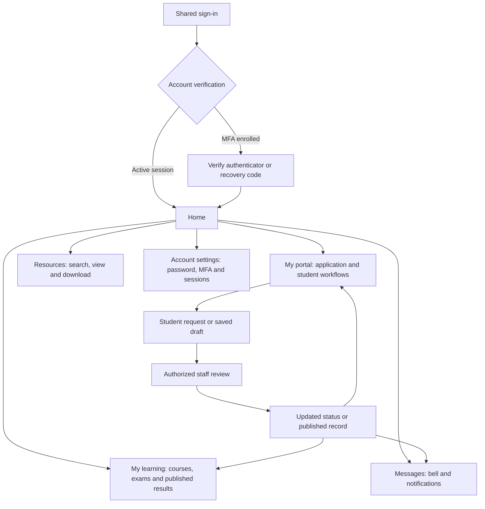

# Student UI Flow and Scrutiny Map

## Current Student Spaces (7 October 2026)

The active-student entry is now `#study/today`, served locally at
http://127.0.0.1:4173/#study/today. The previous walkthrough below is retained
as historical workflow evidence; its old navigation and port are superseded.

| Space / Page | Route | Student functions |
| --- | --- | --- |
| Study / Today | `#study/today` | Greeting, real-data attention, current courses, published upcoming exams, notifications, progress and shortcuts. |
| Study / Courses | `#study/courses` | Semester-filtered offerings and course overview deep links; truthful enrolled/completed/withdrawn state. |
| Study / Timetable | `#study/timetable` | Published exam sittings, venues and arrangements; contextual request continuation in Office. |
| Study / Results & Progress | `#study/results` | Published marks, progression and awards with semester context. |
| Study / Resources | `#study/resources` | Existing resource search, view and download. |
| Office / Overview | `#office/overview` | Registration readiness, record summaries, finance standing and actionable next steps. |
| Office / Registration | `#office/registration` | Course selection, save, confirmation, eligibility/blockers and withdrawal workflows. Unsaved selections cannot be confirmed. |
| Office / Fees & Payments | `#office/fees` | Balances by currency, financial holds, payment plans/instalments and ledger; no online payment action. |
| Office / My Details | `#office/details` | Contact/address updates, identity correction requests, study year/status history and application history. |
| Office / Documents | `#office/documents` | Issued transcript/certificate history and existing viewing/printing. |
| Office / Requests | `#office/requests` | Request tracking with disjoint Open/Awaiting you/Completed filters, next actor, support/enquiries and contextual arrangement details. Identity and withdrawal links continue on their owning pages. |

Both spaces share sign-in, Inbox and Account settings. Programme and semester
context travels in links; mobile context is collapsible and local navigation
scrolls horizontally. Drafts survive same-session page changes and clear on
account change. Students with teaching permissions retain My teaching.

Legacy `#home`, `#apply` and student-only `#learning` entries redirect into the
new spaces; `#apply?history=1` retains accepted-application history. Staff and
applicant routes remain separate. Classes, course materials, assignments,
intraplatform chat and payment collection are not invented by this restructure.

## Historical Walkthrough (6 October 2026)

## Starting Point

- URL: http://127.0.0.1:4188/#signin
- Main walkthrough: active.student@southvalley.test / Active-Student-Demo-2026!
- Person: Tariro Demo Moyo, student S27000019, BSc Information Systems.
- Second student: demo.classmate@southvalley.test / Active-Student-Demo-2026!
- Nyasha S27000020 demonstrates the enrolled lecturer class-list cohort.

The demo uses synthetic 2028 academic periods. Results and timetable records
are already published for inspection; this is not a chronological real student
history or the university's actual calendar.

## Navigation and Entry

The signed-in student's principal navigation is Home, My portal, My learning,
and Resources. On mobile these appear in the bottom navigation with Account.
Messages are reached through the bell or the Home messages panel. Settings
are available from Home and the account menu. A limited System area may also
appear for foundation.view; seeing that route does not grant administration.

Sign-in validates email and password. An account with enrolled MFA must verify
before reaching Home. Forgotten-password recovery is on the sign-in page.
One shared session covers all screens. Sign out before switching demo people.

## Screen Map

| Screen | Route | Purpose | Principal student controls |
| --- | --- | --- | --- |
| Home | #home | Overview of programme, registration, fees and messages | Open portal, Choose your courses, My learning, Results and transcripts, View statement, Open messages, Settings |
| My portal | #apply | Detailed application and student record; requests and approvals | Profile saving, identity correction, course selection/confirmation, withdrawal, exam arrangements, enquiries and support |
| My learning | #learning | Condensed courses, examination timetable and published marks | Registration link, arrangement request, calendar export, Transcripts link |
| Resources | #resources | Authorized repository and library catalogue | Search/filter, choose item, View, Download, Back to search |
| Messages | #messages | Owned notification inbox | All/unread/read filter, refresh, mark read, older/newer pages |
| Account | #settings | Identity summary and account security | Change password, set up MFA, inspect sessions, sign out/revoke sessions as offered |
| Document verification | #verify | Verify issued document codes | Enter verification code; inspect validity/revocation outcome |

Home's Results and transcripts and View statement links currently open the same
general portal route. They do not open dedicated result or finance pages.

## Portal Layout: Top to Bottom

The following order is taken from the live Tariro portal. Sections requiring
existing records appear only when those records exist.

| Position | Section | Contents and actions | Demo state |
| --- | --- | --- | --- |
| 1 | Programme header | Programme, student number, intake/version, sign out | BSc Information Systems, S27000019 |
| 2 | Admissions updates | Optional communication preferences and admissions inbox | Available; no separate campaign walkthrough seeded |
| 3 | Admissions guidance | Search published guidance | Available; content depends on published guidance |
| 4 | Admissions enquiries | Filter existing enquiries; New enquiry | Available; not pre-populated with a student enquiry |
| 5 | Progress | Application stepper, status, decision, application history | Accepted application |
| 6 | Documents | Uploaded application evidence and its state | Synthetic identity/transcript fixtures |
| 7 | Student onboarding | Phone, address, country and next-of-kin form | Complete; Save student profile available |
| 8 | Identity details | Governed identity summary and Request a correction | No pending correction |
| 9 | Study year | Current year and study-year history | Year 1 |
| 10 | Fees and payments | Account summary, charges, payments, allocations and holds | USD 1,250 charged, USD 750 paid, USD 500 balance; currently nothing due |
| 11 | Course registration | Per-period courses, credit count, selection, blockers and confirmation | Completed semester confirmed; later repeat-selection draft blocked |
| 12 | Course withdrawal | Existing requests and request form with reason/evidence | No requests; published results prevent withdrawal of completed courses |
| 13 | Examination timetable | Published sittings, course/paper, venue, duration and calendar export | Two demo sittings |
| 14 | Arrangement cases | Per-exam accommodation requests and case history | No arrangement cases; requests can be started |
| 15 | Student support | New case, filters, queue, selected case and conversation | Timetable question with public staff reply |
| 16 | Published results | Source reference, publication date, GPA and course marks | COMP101: 78/A; INFS101: 65/C; GPA 3/Pass |
| 17 | Programme status history | Status changes, dates and reasons | Conversion and onboarding history |
| 18 | Your details | Original applicant profile and completeness | Complete |

Conditional sections include awards, issued transcripts, academic decisions,
recognized credits, programme transfer history and staff appointments. A
programme-record selector appears when the selected application has multiple
programme records. Application tabs appear when the person has multiple
applications. Their absence in Tariro's demo does not mean those workflows
have been removed.

## Workflow: Admission to Student

Draft -> Submitted -> Payment verified -> Completeness review -> Academic
review -> Decision -> Offer issued -> Accepted -> Student conversion ->
Pending onboarding -> Onboarded.

The applicant owns profile completion, required uploads, fee evidence,
submission, responding to information requests and offer acceptance/decline.
Admissions owns review and the decision. Accepted-offer conversion creates the
student number and programme record. The student supplies contact/next-of-kin
details; registry confirms identity and approves onboarding. Application
withdrawal, offer decline/expiry and deferral are distinct branches.

For scrutiny: inspect Progress, Application history, Documents, Student
onboarding and Programme status history. Tariro starts after this workflow has
completed, so submission and offer-response controls are no longer available.

## Workflow: Registration

Staff prepares the academic calendar, registration period and course delivery.
The student selects courses -> saves the selection -> sees eligibility and
blockers -> staff records applicable clearances/decisions -> student confirms.

Confirmation requires an onboarded student, an open matching period and valid
selection. Controls cover credit limits, core courses, prerequisite evidence,
timetable clashes, academic/financial clearance and financial holds. Repeat
selection needs the appropriate current approved academic decision. Changing
the selection can invalidate prior clearance; confirmation preserves a course
snapshot, reference number and enrolled credits.

For scrutiny: Tariro's completed semester shows the confirmation and 30 credits.
The later semester shows editable selection and disabled Confirm registration,
with repeat-evidence blockers. Nyasha's confirmed registration appears in the
lecturer class list. Do not treat a disabled confirmation button as a successful
registration or remove approval requirements simply to complete this sample.

## Workflow: Fees and Payments

Staff drafts a fee schedule -> another authorized person publishes it ->
billing creates charges -> finance records/reconciles payments -> ledger
allocation updates the balance and financial hold -> the student sees the
statement and receipt notice.

The student does not record their own ledger payment in this UI. There is no
connected checkout/payment gateway in the local demo. An outstanding balance
and an amount due now are different values: Tariro owes USD 500 but the
synthetic charges are not yet due, so the demo has no overdue hold.

For scrutiny: Home shows balance/due totals; Portal shows the detailed account.
Staff-side inspection is in the student record and finance workspace. Payment
plans, sponsorship and adjustments may appear when approved records exist;
none were added to this particular student's walkthrough.

## Workflow: Learning and Results

Confirmed enrolment -> course summaries in My learning. Authorized teaching
allocation -> lecturer class list. Assessment plans/marks or a validated result
export -> independent review -> publication -> student-visible marks/GPA ->
availability notification.

My learning course cards contain code, title and credits. They are not lesson,
assignment or course-content pages, and there is no connected external LMS in
this demo. The study guide lives in Resources. Tariro's results were seeded via
the validated result-batch workflow, not by seeding assessment plans and marks.

For scrutiny: compare results in My learning and Portal. Draft/review-only
results must not appear as official student marks. A Transcripts link opens
Portal; it does not guarantee that an official transcript has been issued.

## Workflow: Exams and Arrangements

Staff schedules sittings -> checks candidates, clashes and required resources ->
another authorized person publishes the timetable -> student sees the published
edition -> downloads .ics or requests an arrangement for a sitting -> authorized
staff reviews and supplies an operational instruction if approved.

Arrangement requests include additional time/separate-room needs, request note
and evidence reference. Requests and approvals are distinct states. Private
staff review/history is not a general student record. Existing arrangement
cases can be filtered and opened from Portal.

For scrutiny: compare My learning and Portal timetables; inspect an arrangement
request and its resulting state. No arrangement approvals were pre-seeded.

## Workflow: Student Requests

| Request | Student location/action | Responsible staff | Outcome shown to student |
| --- | --- | --- | --- |
| Contact changes | Portal / Student onboarding / Save student profile | Student self-service with validation | Updated contact and next-of-kin details |
| Legal identity correction | Portal / Identity details / Request a correction | Registry checks evidence and decision | Requested/approved/rejected correction history |
| Course withdrawal | Portal / Course withdrawal / reason and optional evidence | Independent authorized registry reviewer | Awaiting approval, withdrawn or not approved |
| Exam arrangement | Learning timetable or Portal arrangement cases | Authorized arrangement reviewer | Request state and approved operational instruction |
| Admissions enquiry | Portal / Admissions enquiries / New enquiry | Admissions/enquiry staff | Response and enquiry state |
| Student support | Portal / Student support / New case | Support staff and escalation manager | Public conversation, status, resolution; reopening/closing when offered |

Support and the general notification inbox are separate: a support reply is
read in its case conversation. Internal staff notes and triage/escalation
details must not leak into the student-facing conversation.

## Workflow: Resources, Messages and Security

Resources: search/filter -> choose result -> inspect item/version -> View in
the embedded viewer or Download -> return to search. Files require upload,
clean scan and independent publication before becoming student resources.
The demo contains a student handbook and programming study guide. Students
must not receive repository publishing/retention controls from simple access.

Messages: bell/Home shortcut -> owned inbox -> all/unread/read filter -> mark
read -> unread count updates. Pagination controls enable only when applicable.
Queued notifications shown here do not prove external email delivery.

Settings: inspect name/email/roles/last sign-in -> change password using the
current password -> enroll an authenticator and confirm it -> retain recovery
codes -> inspect/revoke sessions. Settings is not the student contact or legal
identity editing screen. Changing the demo password will affect seeded login
instructions and later provisioner runs.

## Scrutiny Findings and Boundaries

1. Portal is a long combined applicant/student page. It still says Applicant
   portal in its eyebrow for the active student. Communication, enquiries and
   historic admissions content precede current student work.
2. Results/transcripts and statement shortcuts all land at #apply, without
   taking the student directly to the target section.
3. There are no separate course lesson pages. The current Learning screen is a
   summary of registration, examinations and published results.
4. Withdrawal options currently include confirmed courses with published
   results. The form explains the prohibition, but filtering those options or
   showing their ineligibility before submission would be clearer.
5. The repeat draft is intentionally blocked. Future walkthrough improvements
   should add a separately reviewed progression/repeat example rather than
   treat the present control as an error.
6. Transfer, lifecycle and academic decisions are mostly student-visible
   history here; do not assume every staff operation has a student request form.
7. Transcript/award sections are conditional. No official transcript,
   certificate, graduation approval or award was issued for this demo.
8. Resources are authorized repository items, not an LMS. Payment, mail and
   LMS providers are not connected; notification queueing is not delivery.
9. Home and Learning take the first student programme, while Portal permits
   application/programme selection. Multi-programme context deserves explicit
   scrutiny beyond this single-programme demo.
10. Some reads are optional/caught in Home/Learning. A missing panel is not by
    itself proof that there are no records; error visibility needs scrutiny.

## Verification Scope

The demo's six student screens previously passed desktop/mobile checks with
no page errors or horizontal overflow. Lecturer learning/class list, registrar
student workspace and administrator System also passed focused checks. For
this map, a fresh live student sign-in confirmed headings, controls, disabled
registration confirmation and absence of displayed notice errors on all six
screens. This is not a new full browser-suite run or proof of every exceptional
request/approval workflow.

Implementation anchors: src/shell.js (navigation/sign-in), src/home.js
(dashboard), src/apply.js (portal composition and registration), src/learning.js
(courses/results), src/resources.js (repository), src/messages.js (inbox),
src/settings.js (security), and the course-withdrawal, support, examinations,
identity, transcripts and awards UI modules referenced by the portal.
